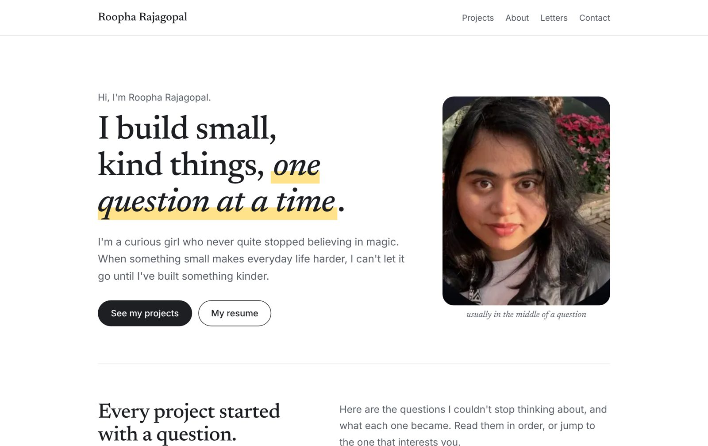
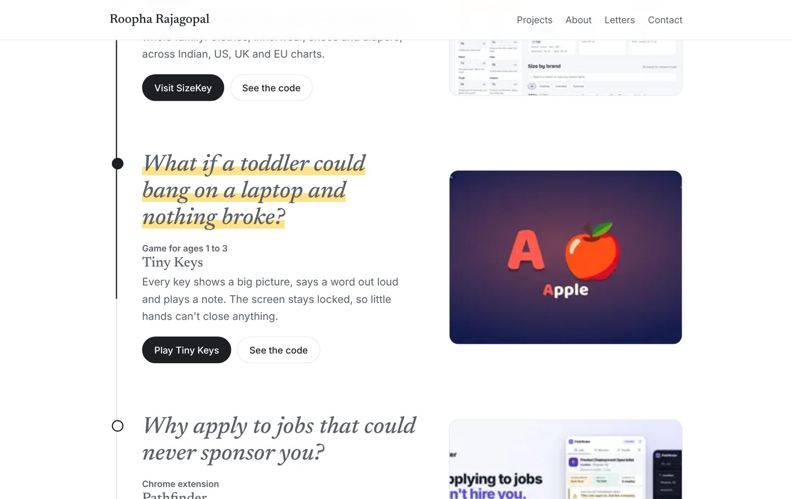
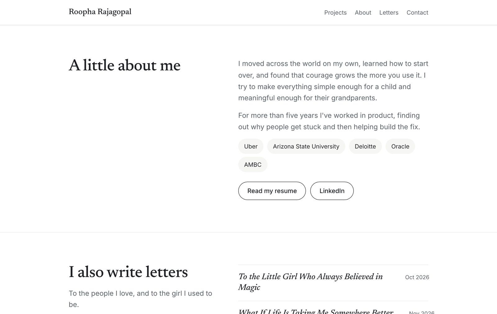
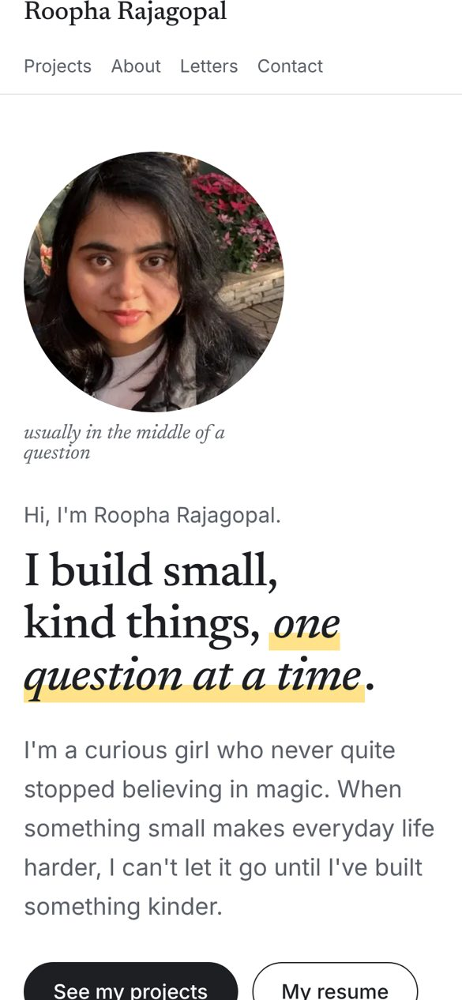
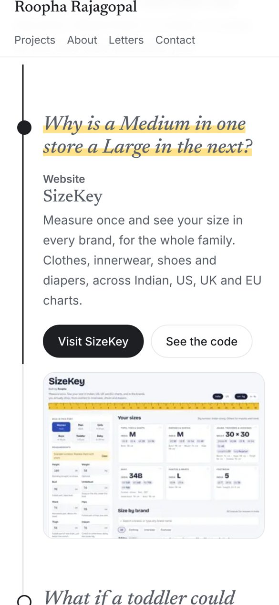
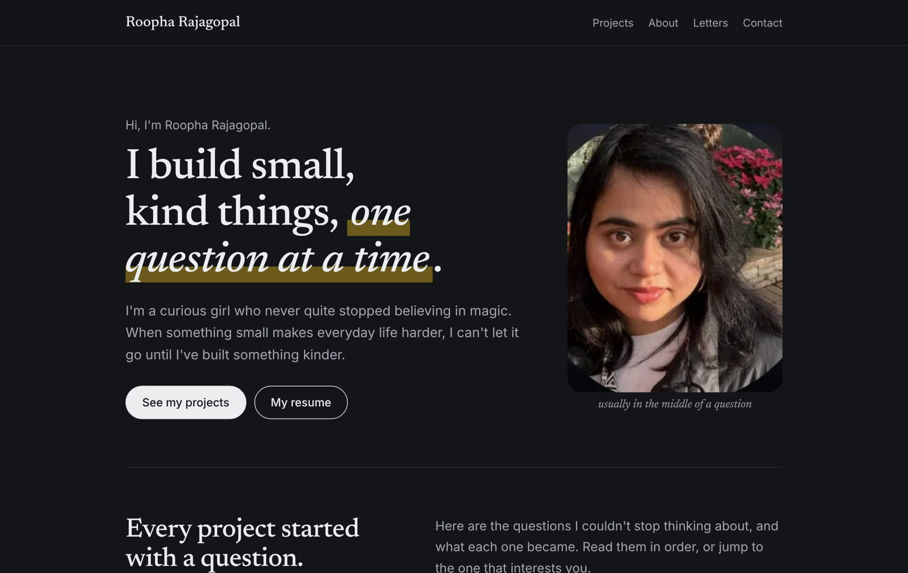

# Roopha Rajagopal

*A curious girl's corner of the internet. Small, kind things, built one question at a time.*

## Why this site exists

Everything I've built started the same way: something small made everyday life harder, and I couldn't stop asking *why*.

Why is a Medium in one store a Large in the next? What if a toddler could bang on a laptop and nothing broke? Why do international students keep applying to jobs that could never sponsor them?

A list of project names doesn't explain any of that, so I wanted a home for my work that tells the story the way it really happened: **the question first, then what it became.**

I also wanted it to feel welcoming to anyone who lands here, whether that's a recruiter, a fellow builder, a teenager or my grandparents. So it had to be:

- **Calm.** White space, one soft yellow highlight, nothing flashing or busy.
- **Easy to read.** Large type, high contrast, and big buttons that are easy to tap.
- **Familiar.** It scrolls like any page. There's nothing to figure out, and everything is visible right away.
- **Still mine.** One quiet idea runs through it: a thread of questions.

## How it's structured

The page is one journey from top to bottom, with five stops.

### 1. Hello
Who I am in one line, a photo, and two clear choices: see my projects or read my resume.

### 2. The question thread
The heart of the site. Each project opens with the question that started it, written large, followed by what I built, why it matters, and two buttons: try it, or see how it's made.

A thin line runs down the left side and fills in as you read. As you reach each question, its dot fills in and a yellow highlighter sweeps underneath it, like someone marking the line that matters.

| Question | What it became |
|---|---|
| Why is a Medium in one store a Large in the next? | **SizeKey**: one size profile for the whole family, across every brand |
| What if a toddler could bang on a laptop and nothing broke? | **Tiny Keys**: a safe keyboard playground for ages 1 to 3 |
| Why apply to jobs that could never sponsor you? | **Pathfinder**: a Chrome extension for international job seekers |
| What if a letter could wait years for the right moment? | **Lettertide**: letters to future you, to loved ones, or to Santa |
| How do you tell a billion people why they light a lamp? | **The Story of Light**: Diwali told in Pattachitra paintings |
| Why can't a grocery app shop for your doctor's advice? | **Health-Aware Grocery**: a design case study |

Smaller things sit just below: Golu Nights, the SizeKey app (coming soon) and Create a Bill, my very first program.

### 3. A little about me
A short, human introduction, the places I've worked, and my resume. It's not the whole resume, only enough to know me.

### 4. Letters
Three of the letters I write on Medium, to the people I love and to the girl I used to be.

### 5. Say hi
It ends the way it began, with a question: *Have a question for me?*

## On every screen

It's designed for phones first, and switches to a dark version on its own when your phone is in dark mode.

  
  &nbsp;&nbsp;
  

## Adding something new

When a new project is ready, it joins the thread with its own question. Projects still being built wait in "A few smaller things" until they launch.

---

Made by Roopha Rajagopal · [LinkedIn](https://www.linkedin.com/in/rroopharajagopal) · [Medium](https://medium.com/@rroopha2026)
